# Iteration 3: compact discovery cards

Baseline: main `05470a84b75b84ce62ad1c66c020bcb6bdcfd1af` (iteration 2). Captured October 12, 2026 UTC in local Chrome using the same public event feed response for both versions. The pictured event is **I Luv Hip Hop**, October 15 at 9 PM, Dulce Lounge; artwork, title, category, description and timestamp come from actual canonical event data. No production records were written. Test-only boundary cases are separate from screenshots.

## Changes and reuse

- `HomeOpportunityCard.tsx` / `.css`: shared compact presentation for events, offers and missions. A responsive 2:1 media container uses `object-fit: contain`, preserving all original artwork without cropping. Missing/failed artwork gets a neutral labeled fallback. Natural card height grows with identity text; only descriptions clamp to two lines.
- Identity order: opportunity type and supplied category → title → localized date/time → venue → short description → one CTA. Labels are **View event**, **View offer**, and **Explore mission**, localized in English, Spanish and Brazilian Portuguese. Missing data stays absent; invalid dates cannot crash rendering. Offer dates retain the existing “Available until” wording.
- `HomeOpportunities.tsx`: retains its existing inventory, tabs, loading/error/retry behavior and selected category. Adds touch/pen horizontal swipes and left/right keys on the focused carousel. Vertical/short/canceled gestures and interactions originating on links do not advance it. Native CTA swipe checks confirm no accidental route navigation. No autoplay or new carousel dependency.
- Navigation uses smaller 32px arrow outlines inside 44px touch targets and an unobtrusive 11px counter with a polite screen-reader status. A horizontal rail was unnecessary: retaining the existing carousel avoids changing selection, loading and routing architecture.
- `home-opportunities.ts`: retains source models, eligibility, ranking and destinations. The existing presentation adapter now exposes concise descriptions and the supplied event category, rather than using offer terms or mission reward explanations as homepage copy. Offers currently supply no artwork in this model, so they use the honest fallback; missions retain their linked event artwork.
- `PublicMarketHome.css`: removes obsolete detailed-card rules. Header, hero, other homepage sections and navigation remain unchanged.
- Reused: React Router `Link`, `usePublicOffers`, canonical moment data, the existing mission query, `HomeOfferRequest` for **Your next offer**, localization and icon components. No dependencies added.

## Routing and conversion

Event, offer and mission actions keep `/moments/:slugOrId`, `/offers/:id` and `/missions/:id`. The second homepage signup CTA and account/benefit boilerplate are removed from the preview only. PublicMomentDetail retains full event descriptions, associated offers and its authentication return link; MomentDetail retains RSVP, check-in and attribution; OfferDetail and useCommerceActions retain claim/auth handling and terms; ContentMissionDetail retains mission actions and participation requirements. These detail routes and business handlers were not edited. No new signup barrier, analytics change, backend/schema change or production data mutation is introduced.

## Card measurements

CSS pixel measurements for the same real event; card height excludes tabs and navigation controls. The compact card is shorter at every tested width. Its artwork now precedes identity, so the CTA sits lower within the first viewport than iteration 2 even though the complete card is shorter.

| Viewport | Card height: before → after | After: CTA bottom from viewport top |
|---|---:|---:|
| 320 × 568 | 473 → 342 | 619 |
| 360 × 800 | 473 → 362 | 640 |
| 375 × 667 | 473 → 369 | 651 |
| 390 × 844 | 473 → 377 | 661 |
| 430 × 932 | 456 → 397 | 683 |
| 768 × 1024 | 645 → 363 | 628 |
| 1440 × 1000 | 624 → 501 | 697 |

At 360×800, 390×844 and 430×932, artwork, identity, description, CTA and controls fit in the first screen. At 320×568 and 375×667, a short scroll is needed to expose the complete action and controls. This is the explicit artwork-first tradeoff; no first-viewport guarantee is claimed for short screens or long titles. At tablet/desktop, the existing two-column hero remains functional.

## Screenshots

| Width | Before | After |
|---|---|---|
| 320 | 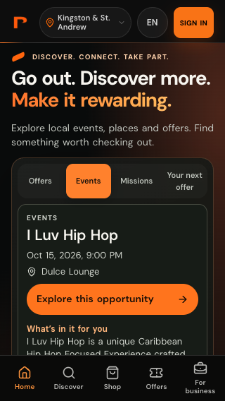 | 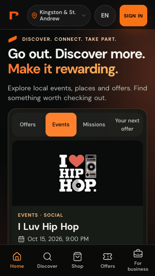 |
| 360 |  | 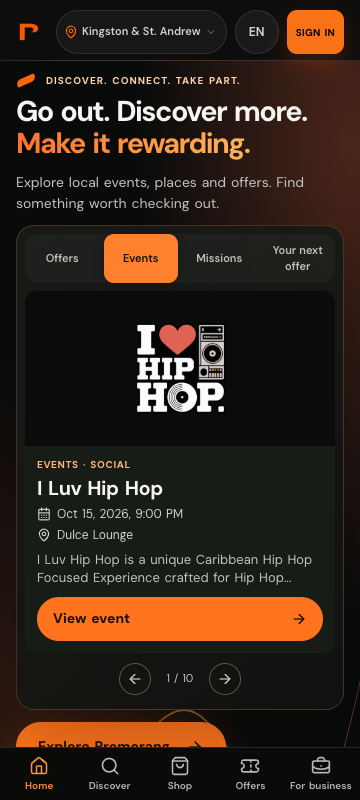 |
| 375 | 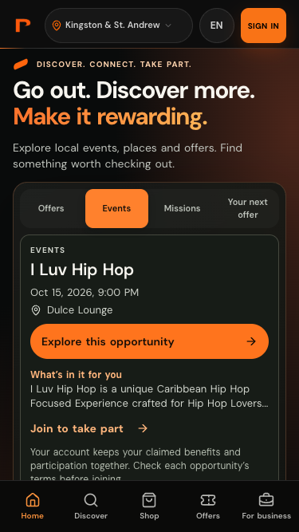 | 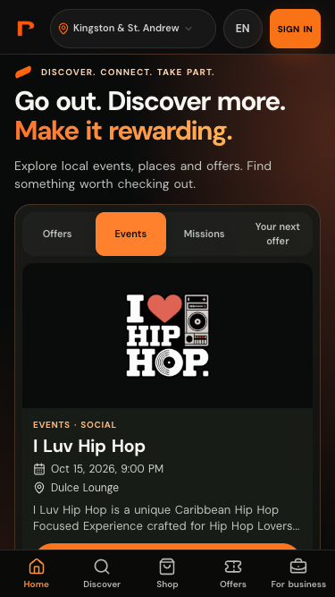 |
| 390 | 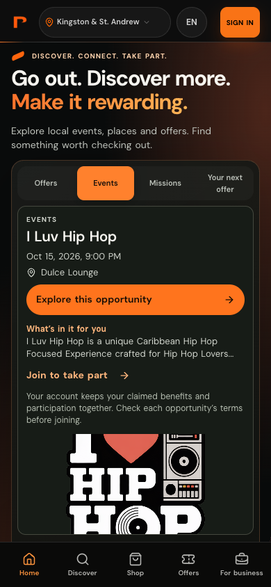 | 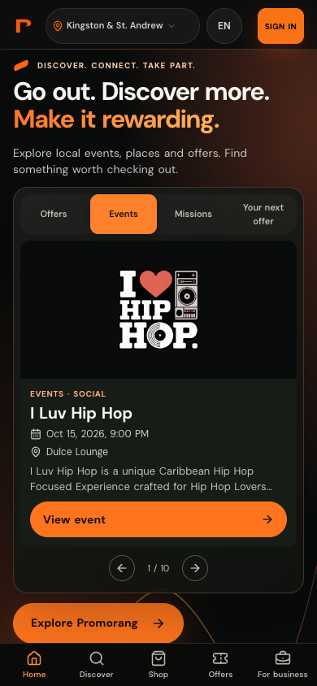 |
| 430 |  | 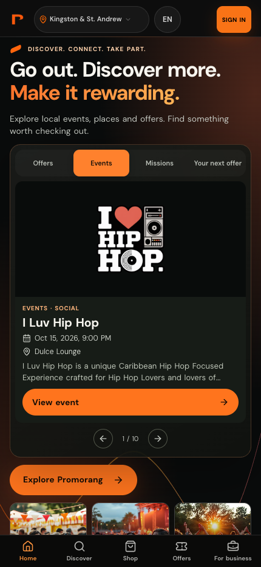 |
| 768 | 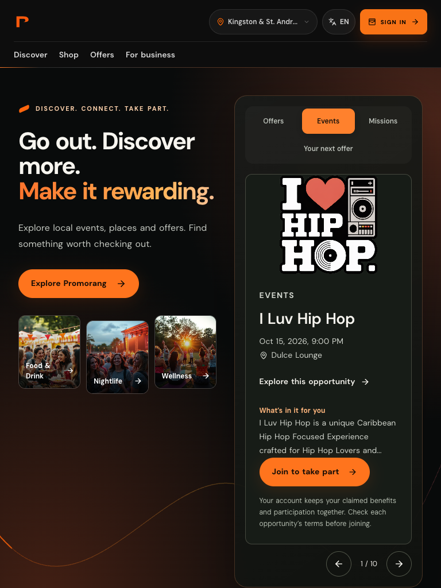 | 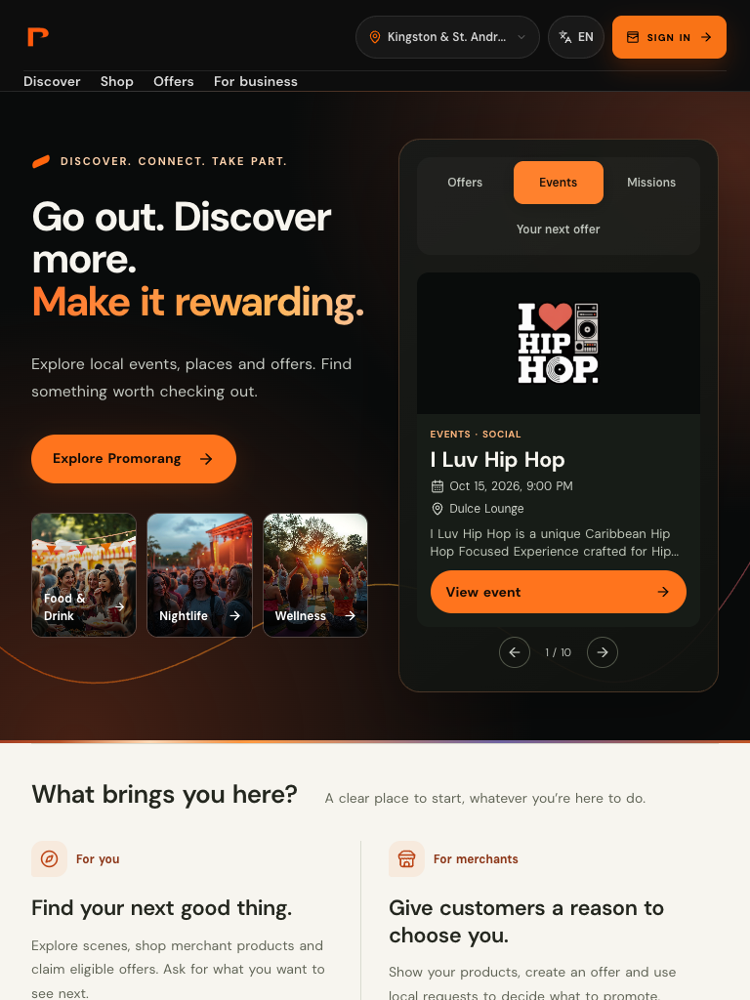 |
| 1440 | 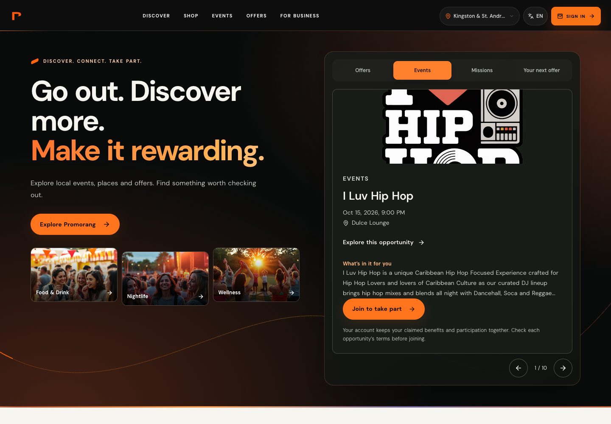 | 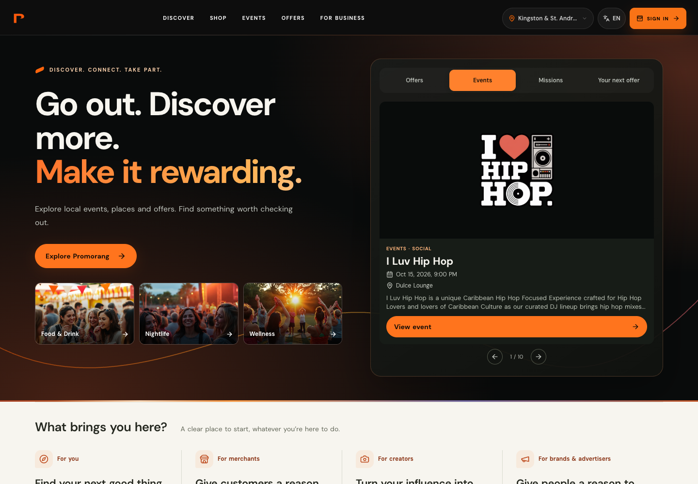 |

## Verification

- 42 focused tests pass across card boundaries, carousel gestures, inventory mapping, homepage, existing commerce actions and localized detail surfaces. One new assertion initially expected “Ends”; corrected to the unchanged existing “Available until” wording, and all four card-boundary tests pass on rerun.
- Full web ESLint: zero errors, 118 existing warnings. Changed files also lint cleanly.
- Production build passes; SEO generation produces 30 localized snapshots and 54 sitemap URLs. Existing bundle-size warnings remain.
- TypeScript check remains blocked by 547 existing diagnostics; normalized before/after diagnostics have no additions or removals. This is not a clean repository-wide typecheck.
- Browser checks pass at 320, 360, 375, 390, 430, 768 and 1440px: no horizontal overflow, contained artwork, consistent media proportions, two-line descriptions, unclipped CTA, one link per card, correct ISO/localized date, working buttons, arrow keys, native Chromium touch swipes, preserved Events selection, safe CTA gestures and correct detail routes. Long unbroken titles and long venue text remain within the viewport.
- No uncaught JavaScript exceptions. The console is **not fully clean**: the local environment has unconfigured `unavailable.supabase.co` requests and the existing mission feed returns 404. QA intentionally blocks external writes (including growth-ops analytics POSTs), producing additional failed-request logs. These are recorded separately in `after/report.json`; no production service or analytics configuration was changed to hide them.
- Missing artwork and bad timestamps are covered by tests; offers and missions use controlled unit fixtures because usable live mission inventory is unavailable. Real authenticated RSVP, claim and purchase transactions were not performed; unchanged commerce behavior is covered by existing tests and route inspection.
- Safari/WebKit and physical iOS were not verified: this host's macOS 13 cannot install the available Playwright WebKit build. Prior safe-area CSS remains unchanged. Device/browser-toolbar testing is still advisable before release.

## Reproduce browser checks

Run a local app on port 4180. Capture the public `/api/moments/feed` response to a JSON file (requires at least two current events in the default market), then run:

```sh
FEED_FIXTURE=/path/to/feed.json \
PLAYWRIGHT_MODULE=/path/to/playwright \
CHROME_EXECUTABLE=/path/to/chrome \
node apps/web/scripts/verify-compact-opportunities.cjs
```

Optional `MOBILE_UX_BASE_URL` and `MOBILE_UX_OUTPUT` override the server and output directory. The script blocks external writes. All screenshots use the captured event response, never invented event inventory.

This iteration is prepared for PR review only. No production deployment is authorized by this brief.
