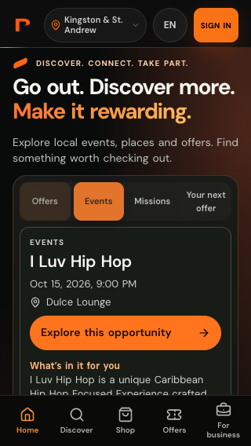
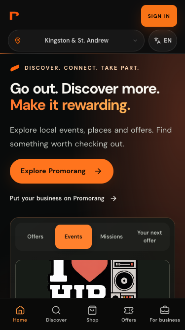
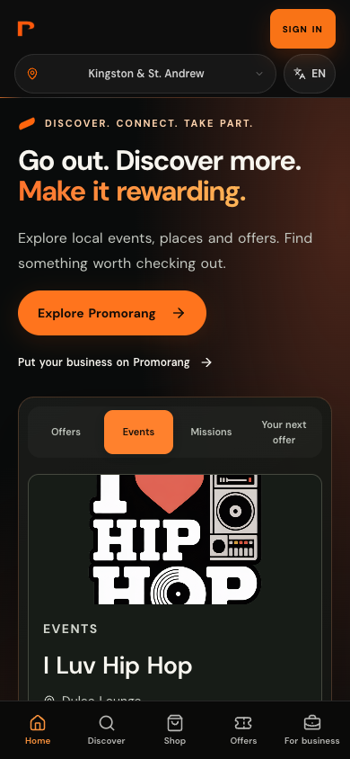
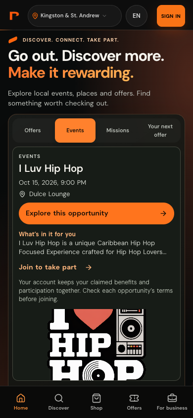
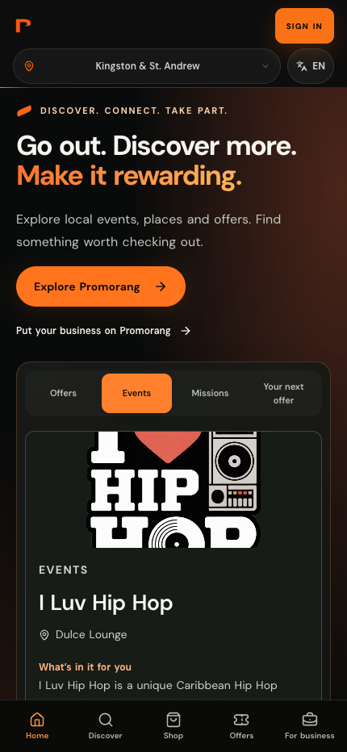
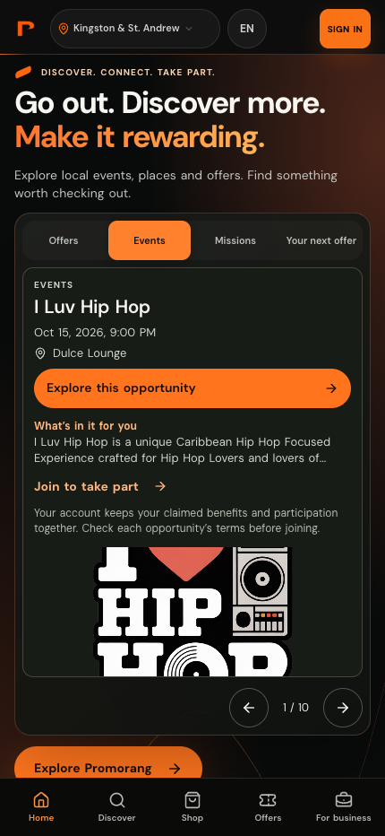

# Mobile homepage density refinement

Measured against main `3c8e07413368942b295d677e022bcba8b7f8f940`, using local Chrome and the same captured response from the public `https://api.promorang.co/api/moments/feed` endpoint on October 12, 2026 UTC. The displayed event is **I Luv Hip Hop**, October 15, 2026 at 9 PM, Dulce Lounge. No inventory was fabricated or production data changed. Date rendering uses the browser timezone (America/Jamaica in this run). Measurements describe settled content, not loading performance.

## First viewport

Coordinates are CSS pixels from the viewport top. Visibility excludes the fixed bottom navigation. Header height changes from **109px to 61px** at every mobile width. Headline, branding, location selection, language selection, sign-in/card links, and account return destinations are retained. Event details move before supporting copy; the image follows the card body on mobile. The business acquisition link moves into the secondary paths section; existing business navigation remains.

| Viewport | Event title top: before → after | Details action bottom: before → after | After: title/date/venue/action fully visible |
|---|---:|---:|---|
| 320 × 568 | 792 → 320 | 1038 → 446 | Yes (navigation starts at 503) |
| 375 × 667 | 721 → 325 | 967 → 450 | Yes (navigation starts at 602) |
| 390 × 844 | 724 → 327 | 970 → 453 | Yes (navigation starts at 779) |
| 430 × 932 | 731 → 329 | 977 → 455 | Yes (navigation starts at 867) |

Previously the title was outside the usable first viewport at 320 and 375, and visible at 390 and 430; the date and action were outside it at every size. Actual results vary with title length, language, inventory, and browser chrome. Empty/error states remain truthful and retain their existing request/retry behavior.

## Paired screenshots

| Width | Before | After |
|---|---|---|
| 320 |  |  |
| 375 |  |  |
| 390 |  |  |
| 430 |  |  |

## Verification and limitations

- 28 existing tests pass across HomeOpportunities, opportunity mapping, PublicMarketHome, PublicHomeBar and PublicMobileNavigation. These cover empty/error inventory, anonymous detail links, signup return targets, city filtering, auth links and route selection.
- Changed TSX files pass ESLint. Production Vite build and localized SEO generation pass (existing chunk-size warning).
- No horizontal page overflow at 320, 375, 390, 430, 768 or 1440. Desktop composition inspected at 1440.
- Location dropdown opens and filters Miami; language switches to Spanish and back to English at all four phone widths without horizontal overflow.
- CSS retains `env(safe-area-inset-top)` and bottom navigation safe-area padding; header adds left/right safe-area padding. Chrome simulation imposes 47px top and 34px bottom insets. At 375/390/430 × 844, event action remains fully visible. At the deliberately extreme 320 × 568 with these notch insets, its bottom is 489px versus navigation top 477px: about 12px of scrolling is required, while title/date/venue remain visible.
- **Physical iOS Safari and WebKit are unverified.** Playwright WebKit installation fails because the available version does not support this host's macOS 13. Synthetic spacing is not a substitute for device/browser-toolbar verification. Check a real iPhone before release, including expanded/collapsed browser bars, rotation and keyboard opening.
- Existing offer/mission endpoint failures are outside this layout PR; no backend, authentication, models or business workflows were changed. The screenshots use actual events, not replacement offers or missions.

## Home versus Discover

There is overlap in category entry points and inventory, but Home currently provides brand orientation, a small opportunity shortlist and stakeholder paths. Discover provides search, filters and deeper browsing, with additional signed-in behavior. Recommend sharing discovery presentation components and reducing repeated introductory content in a later iteration. Keep both routes and navigation entries until usage evidence and an approved migration establish whether a single entry point is appropriate. This PR removes no routes or capabilities and is not deployed to production.
