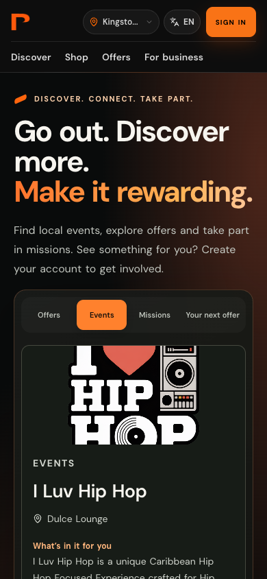
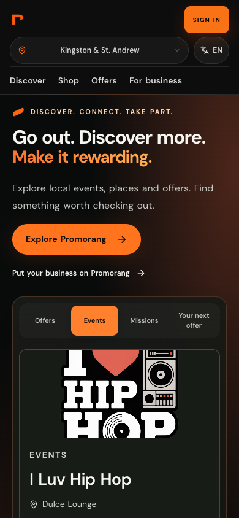
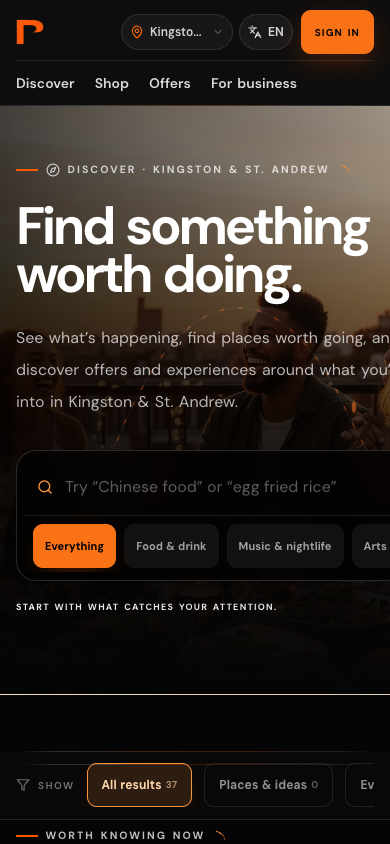
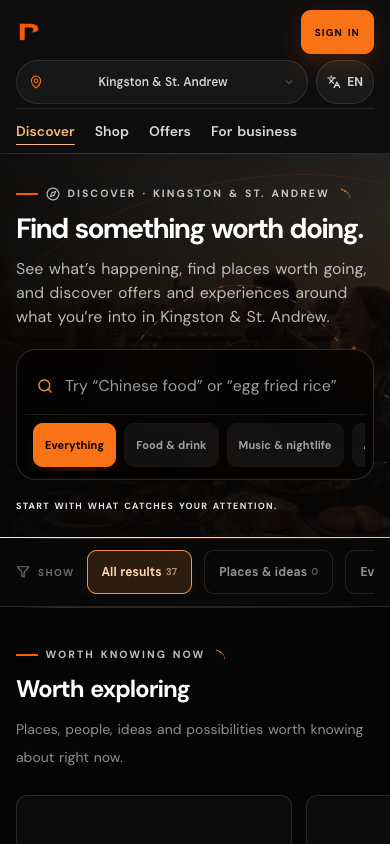
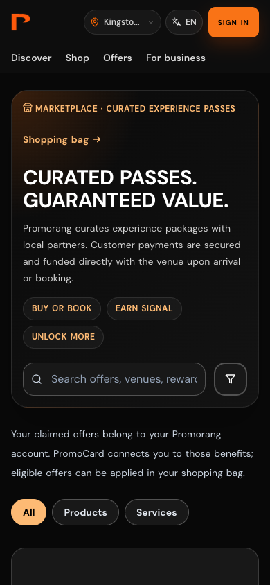
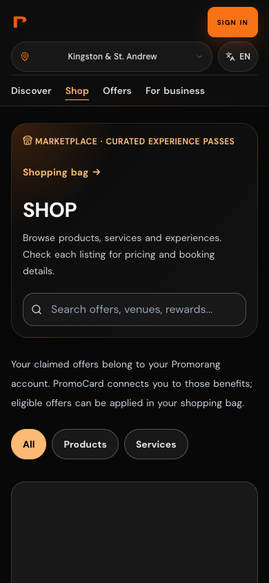
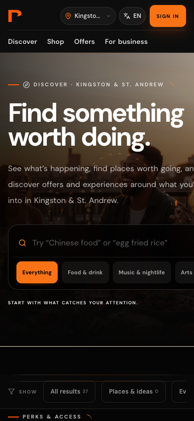
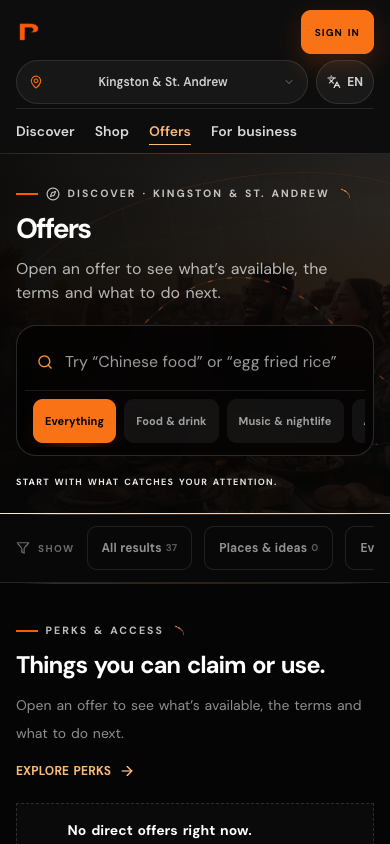
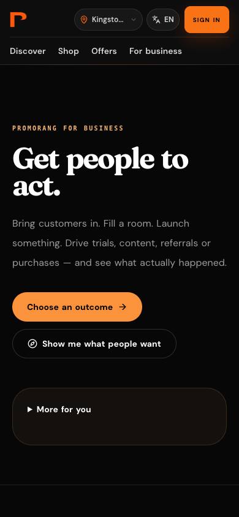
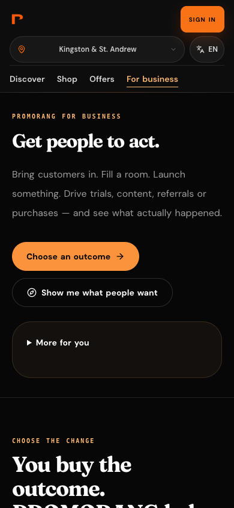

# Promorang mobile UX audit and verification

Baseline: `5485d7342` (`main`). Branch: `codex/mobile-ux-consolidation`.

This is an incremental public-web pass. The original checkout's uncommitted material/design work was preserved in its own checkout and is not included here.

## Audit and implementation plan

The web app uses React 18, Vite, React Router 6, Tailwind/shadcn/Radix, React Query, and Auth/Market/i18n contexts. Shared domain models live in `packages/shared`. Existing lazy routes and account/commerce hooks remain in place. Breakpoints are principally Tailwind's 640/768/1024/1280px thresholds, with additional CSS rules at 359/639/767/1023px. Layered marketing styles sometimes override component utilities, including an important mobile heading rule.

| Severity | Surface / component | Finding | Correction |
| --- | --- | --- | --- |
| High | Discover / `PublicDiscoverExperience` | Flex child did not shrink around a horizontal chip rail; oversized cinematic minimum height and later heading CSS overrode mobile sizing | Explicit full-width/min-width-zero column; content-sized hero; scoped heading rules; earlier search and results |
| High | Discover PromoCard section | Implicit grid minimum used card/text content width; broad ancestor clipping concealed it | Explicit `minmax(0, 1fr)` grid tracks and shrinkable children; remove masking clipping from public shell |
| High | `PromoCardObject` / `/app-preview/card` and public card introduction | Preferred aspect ratio plus full-height inner stack clipped card text vertically | Preserve preferred proportion as a container-relative minimum height; allow content growth; smaller headline and wrapping credentials/holder |
| High | `PublicHomeBar`, `CityQuickSwitcher` | Logo, location, language and auth competed on one narrow row; location dropdown was a fixed 320px before collision padding | Readable mobile location row; existing language and account entry retained; viewport-bounded, vertically scrollable location menu |
| Medium | Global public navigation | No active state; Offers has a different purpose from Shop | Query-aware active state, including searched Offers; Shop stays active on category pages; preserve destinations |
| Medium | Shop / `Marketplace` | Promotional copy included a payment guarantee; dead filter button; explanation chips delayed browsing | Simple localized Shop title and listing-based description; remove no-op button and promotional chips; retain functional category filters, bag and checkout |
| Medium | Home / `HomeIntroduction`, `PublicMarketHome.css` | 43px mobile heading and long onboarding copy delayed a useful action | Fluid 28–36px mobile headline, shorter localized description, primary discovery action before opportunity content |
| Medium | Discover data feedback | Discovery/moment errors could appear as empty results | Explicit failure feedback and retry controls; Offers retry retained in its error state |
| Medium | Business / `SolutionsHub` | Large top padding and mobile heading delayed CTA | Compact mobile opening, existing outcome-led heading and both working destinations preserved |
| Medium | Rails / `index.css` | Later negative rail margins exceeded narrower section padding | Scoped rail margins; keep intentional horizontal scrolling |
| Medium | Accessibility | Search semantics/focus inconsistencies, small controls, nested public main landmarks | Search input semantics, focus indicators, larger language/clear/category targets; public layout wrapper becomes a div |

Implemented in phases: fix intrinsic sizing/header/card; compact home/discovery; refine Shop/Offers/business and navigation; run browser and regression checks. Existing components and brand tokens were reused instead of introducing another design system.

## Route and dependency map

| Destination | Purpose / implementation | Decision |
| --- | --- | --- |
| `/` | `Index` → `PublicMarketHome`, `HomeIntroduction`, `HomeOpportunities` | Keep home and logo navigation; show action/content sooner |
| `/discover` | Public `PublicDiscoverExperience`; signed-in `Discover` retains existing role logic | Preserve both experiences and their data hooks |
| `/discover?tab=perks` | Published promotional offers from `usePublicOffers` | Label page Offers, keep separate from shopping |
| `/shop`, `/shop/category/:category` | `Marketplace` reads commerce directory and links to item details | Preserve listing/filter models and checkout links |
| `/shop/cart`, checkout | Existing commerce flow | No payment behavior changed; verify bag destination only |
| `/card` | Protected `MyPromoCard`; public preview at `/app-preview/card` | Keep protection; anonymous CTA returns to card after signup |
| `/offers`, `/dashboard/offers` | Protected `OfferStudio` for business operations | Do not repurpose as the public Offers destination |
| `/solutions` → `/business/start` | `SolutionsHub`, outcome-driven business entry | Keep “Get people to act.” and outcome CTA |
| `/discover?tab=wants` | Existing demand destination for businesses | Keep “See what people want” route |
| `/auth`, `/post-login`, onboarding | Existing auth/role routing | No authentication or authorization changes |

`PublicHomeBar` serves marketing/public discovery pages; `Header`, `DashboardLayout` and `ParticipantWorldLayout` serve other contexts. These are role-dependent shells, not duplicates that can safely be deleted. Location and language continue using their existing contexts and Radix menus. Home's category links, Discover's interest/result filters and Shop's category routes remain operational.

Navigation recommendation: retain Discover, Shop, Offers and For business for this pass. Keep Home reachable via the logo and account/card via the account control. Do not introduce generic Saved or Take Part tabs: their relevant functions are distributed across authenticated card/moment workflows, and replacing routes would need a separate role-aware information architecture test. Business remains accessible in the current nav pending that test.

## Implementation inventory

- Shared public shell/header: `PublicHomeBar.tsx`, `LanguageSelector.tsx`, `CityQuickSwitcher.tsx`, `AppLayout.tsx`.
- Discovery and card: `PublicDiscoverExperience.tsx`, `PromoCardObject.tsx`, scoped rules in `index.css`.
- Home: `PublicMarketHome.tsx`, `PublicMarketHome.css`, localized shorter copy in `catalog-more.ts`.
- Commerce/business: `Marketplace.tsx`, `SolutionsHub.tsx`, English/Spanish/Portuguese Shop copy in `translations.ts`.
- Tests: new `PublicHomeBar.test.tsx`; revised Shop copy expectations; scoped clipboard-error assertion in `MyPromoCard.test.tsx` to its dialog rather than an unrelated background progress status.
- Reusable browser verification: `apps/web/scripts/verify-mobile-ux.cjs`.

No database, auth, payment, deployment configuration, or package dependencies changed. No inventory, rewards or engagement metrics were added.

## Verification

- Production build: **passed**, including localized SEO snapshots; existing large chunk warning remains (largest reported chunk approximately 1.66 MB before gzip).
- ESLint: **passed with 118 warnings, zero errors**.
- TypeScript: **fails with 547 diagnostics**. An untouched archive of the baseline commit reports the same 547 diagnostics; normalized diagnostic comparison found no additions or removals. Existing failures include generated data-model mismatches and shared types.
- Targeted Vitest suite: **49/49 passed across seven files**; covers public home, navigation, marketplace copy, PromoCard face/gateway/journey and auth roles/locales.
- Chrome responsive matrix: **54/54 passed** across six surfaces × 320, 360, 375, 390, 414, 430, 768, 1024 and 1440px. Checks page width, content bounds and card internal dimensions. Intentional scroll containers and decorative SVG artwork are excluded from content-bounds assertions.
- Public interactions: **passed** for Discover category selection/clear search, location search/menu fit, language menu, Shop search/category, bag destination, business outcome CTA and PromoCard signup return destination.
- JavaScript page errors during the final browser run: **none**. Expected missing-backend/network diagnostics are not treated as a successful data-loading test.
- `git diff --check`: passed.

At 390px, measured Discover hero height changed from approximately 589px to 384px, and search moved from y≈475px to y≈374px. Home's mobile headline changed from 43px to 31px. These are layout measurements, not performance or comprehension claims.

### Reproduce browser checks

Start the web app on port 4180, supply Playwright from your test environment, and run:

```sh
PLAYWRIGHT_MODULE=/absolute/path/to/playwright \
CHROME_EXECUTABLE=/absolute/path/to/chrome \
node apps/web/scripts/verify-mobile-ux.cjs
```

Optional `MOBILE_UX_BASE_URL` and `MOBILE_UX_OUTPUT` configure the local server and evidence directory. The script blocks non-GET/HEAD requests. It does not sign in, claim benefits or purchase anything. Use the default English locale for the interaction assertions.

### Limits and remaining testing

The preview has no configured Supabase credentials. Public API GETs may show real current events; Supabase-backed sections show loading/error/empty states. No production data was modified. Screenshots can therefore differ in inventory state and are not deterministic marketing fixtures. The PromoCard screenshot is the existing anonymous preview, not a signed-in account.

Physical iOS Safari/Android Chrome, virtual keyboards, text scaling across every locale, screen-reader reading order, authenticated end-to-end flows, stocked checkout and live transactions were not tested. Unit tests cover account/card behaviors with existing mocks. No live financial transactions were made. A full WCAG conformance audit is still needed. No LCP/INP/CLS, conversion or visitor-comprehension improvement is claimed; user testing is required. Existing global architecture, data fallbacks, and large bundles remain outside this incremental pass.

## Before / after evidence

Each pair is a 390×844 viewport screenshot. Matching 320px screenshots are also in `before/` and `after/`. The machine-readable viewport report is [responsive-report.json](responsive-report.json).

| Surface | Before | After |
| --- | --- | --- |
| Home |  |  |
| Discover |  |  |
| PromoCard |  |  |
| Shop |  |  |
| Offers |  |  |
| For business |  |  |
